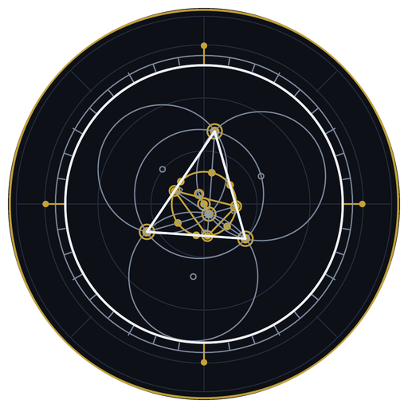
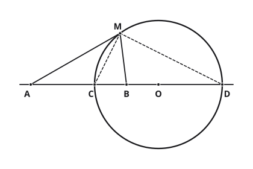

<a href="https://geometor.github.io/altshiller-court/"></a>

# GEOMETOR • altshiller-court

**Visit the Online Archive:** https://geometor.github.io/altshiller-court/

<p align="center">
  <a href="https://geometor.github.io/altshiller-court/"></a>
</p>

**Nathan Altshiller-Court • College Geometry • semantic digital archive**

## Mission

`geometor/altshiller-court` is part of the interconnected [GEOMETOR](https://geometor.com) semantic digital archive. It establishes a multi-track Book Codex and digital scriptorium for Nathan Altshiller-Court's landmark modern synthetic geometry treatise on the triangle and the circle. The archive liberates the work from static print bounds into addressable semantic units, calibrated theme-adaptive vector diagrams, primary-source folio provenance across 334 scanned pages, and exact symbolic connections across the GEOMETOR corpus.

## Books in This Archive

- [College Geometry](https://geometor.github.io/altshiller-court/college_geometry/) — An Introduction to the Modern Geometry of the Triangle and the Circle (1952), featuring 699 numbered articles, synthetic proofs, and reconstructed Euclidean diagrams.

## Repository Contents

- `docsrc/` — Multi-track Book Codex, apparatus, and Sphinx documentation compiled by [PHOTON publish](https://github.com/photon-platform/publish).
- `resources/` — Digital scriptorium workspace containing 334-folio high-resolution scans, structure map, folio transcriptions, figure extractions, and scholarly registries.
- `src/geometor/altshiller_court/` — Python ingestion tools, figure extractor, semantic SVG compiler, and Book Codex generator.

## Local Build & Verification

```bash
publish build
uv run --no-sync pytest
```
## Part of the GEOMETOR Knowledge Archive

Explore all **74 Book Codices** and **11 Mathematical Catalogs** at https://geometor.com/books/.
