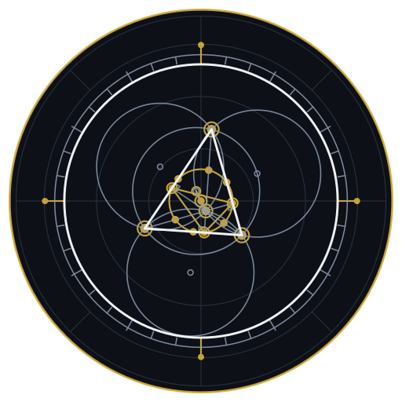

:site_title: Nathan Altshiller-Court

.. container:: author-overline

   semantic digital archive • the works of

=======================
Nathan Altshiller-Court
=======================

**Nathan Altshiller-Court** (1881–1968), long-time Professor of Mathematics at the University of Oklahoma, bridged classical Euclidean straightedge-and-compass craft with the rich nineteenth-century geometry of the Euler line, the nine-point circle, inversion, and the modern triangle. This digital archive presents his celebrated *College Geometry* (1952) as a navigable Book Codex complete with interactive vector diagrams, commentary tracks, and page-linked folio provenance.

Books in This Collection
------------------------

.. container:: home-book-hero

   .. container:: home-book-thumb plate-light

      .. image:: college_geometry/ch03-properties-of-the-triangle/hero.svg
         :alt: Triangle ABC with circumcircle, Euler line O-G-N-H, nine-point circle, incircle, and Feuerbach point
         :target: college_geometry/index.html

   .. container:: home-book-body

      .. rubric:: Second Edition · 1952 (Dover 2007) · 10 Chapters · 699 Articles

      **College Geometry** — *An Introduction to the Modern Geometry of the Triangle and the Circle*, spanning geometric constructions, similitude and homothecy, triangle and quadrilateral properties, the Simson line, transversals, harmonic division, coaxial circles, inversion, and symmedian geometry across **334 scanned folios**.

      .. container:: home-actions

         * :doc:`Open College Geometry → <college_geometry/index>`
         * :doc:`Chapter I: Constructions → <college_geometry/ch01-geometric-constructions/index>`
         * :doc:`Chapter III: Triangle Properties → <college_geometry/ch03-properties-of-the-triangle/index>`

Key Features
------------

.. container:: home-feature-grid

   .. container:: home-feature-card

      **699 Numbered Articles & Exercises**

      Every theorem, locus, construction, and exercise set across ten chapters occupies its own standalone page, accompanied by dedicated commentary tracks and cross-references.

   .. container:: home-feature-card

      **Interactive Calibrated Diagrams**

      Reconstructed ``.euclid-graphic`` vector figures—from Apollonian circles and nine-point tangencies to harmonic pencils and Brocard points—support each synthetic proof.

   .. container:: home-feature-card

      **334-Folio Archival Provenance**

      Marginal folio and page milestones trace every article directly to high-resolution scans of the 1952 edition, documented in the :doc:`Scan Inventory <college_geometry/scan-inventory>`.

Reference & Project
-------------------

.. container:: home-columns

   .. container:: home-col

      .. rubric:: Scholarly Apparatus

      * :doc:`People <college_geometry/people/index>` — Biographical register of 67 geometers and scholars cited across the treatise
      * :doc:`Bibliography <college_geometry/bibliography>` — Systematic bibliography and periodical key (31 entries)
      * :doc:`Technical Glossary <college_geometry/glossary>` & :doc:`Scan Inventory <college_geometry/scan-inventory>` — Synthetic geometry terms and folio audit

   .. container:: home-col

      .. rubric:: About This Project

      * :doc:`About <about/index>` — Editorial scope, scriptorium workflow, and codex organization
      * :doc:`Using This Edition <usage/index>` — Navigation guide, folio milestones, and interactive diagram features
      * :doc:`Python Modules <modules/index>` — Ingestion tools, figure extractor, and semantic SVG compiler

.. toctree::
   :hidden:
   :maxdepth: 2

   college_geometry/index
   college_geometry/people/index
   college_geometry/bibliography
   usage/index
   about/index
   modules/index
